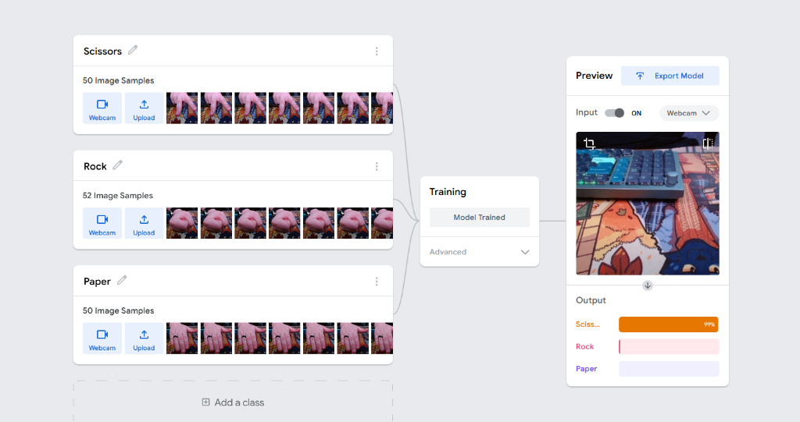
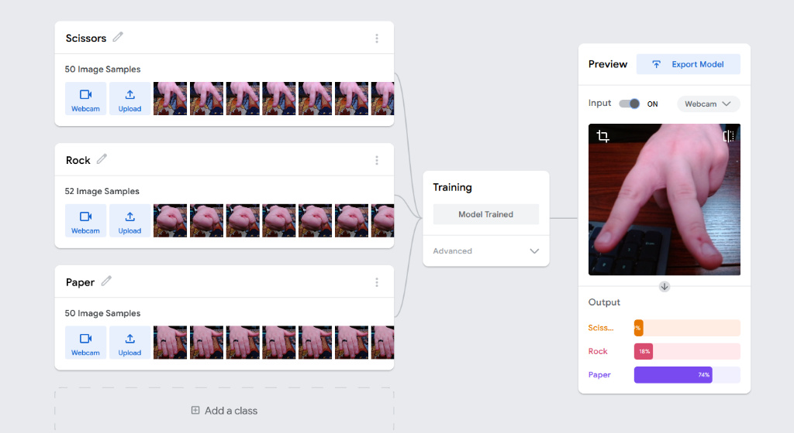
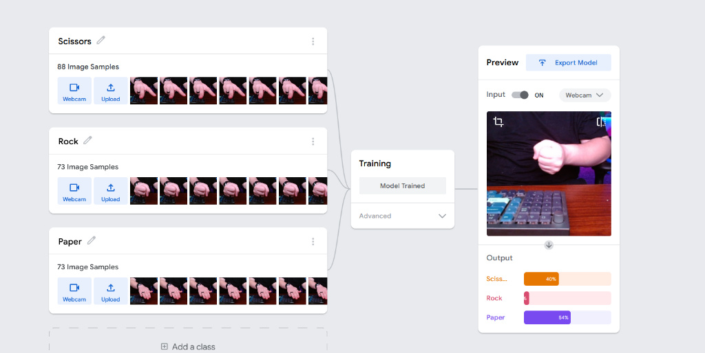
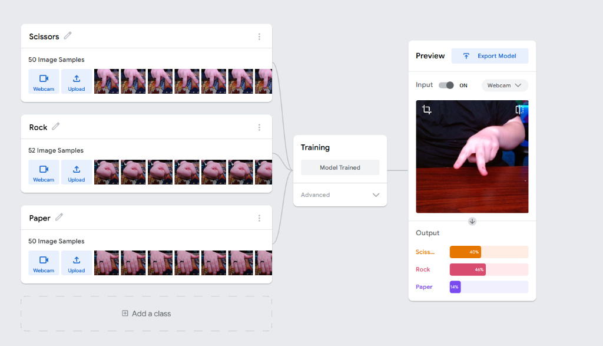
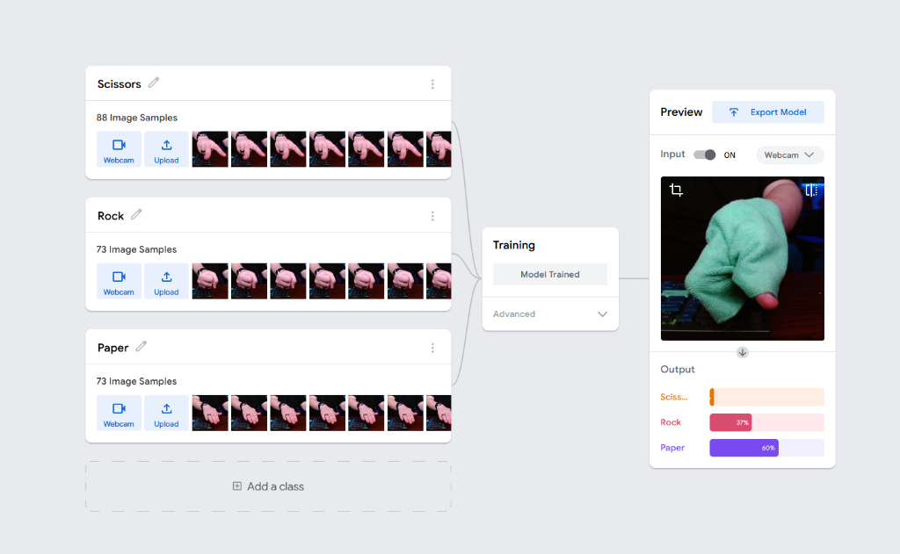
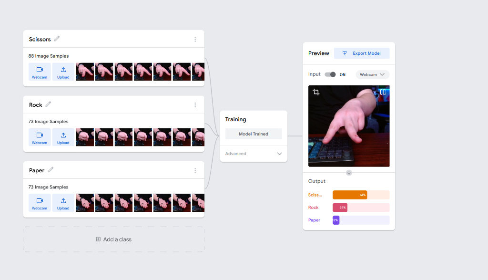

# CSCI 130 — Week 5: Custom Image Classifier & Dataset Bias
**Name:** Brett Whitney

---

## Part 1 — Build Your Dataset

### 1.1 Task Selection
I chose **Hand gestures — rock, paper, scissors** (3 classes). It has three distinct finger silhouettes, requires no extra props, and makes it easy to isolate how changes in background texture, lighting, distance, and hand appearance affect model predictions.

### 1.2 Dataset Summary
- **Platform:** Google Teachable Machine (Standard Image Model)
- **Classes:** `Scissors` (50 image samples), `Rock` (52 image samples), `Paper` (50 image samples)

### 1.3 Baseline Capture Conditions
| Condition | Recorded Setup |
| :--- | :--- |
| **Where you were** | Home office desk |
| **Lighting** | Overhead room light on, monitor glow, blinds closed (evening) |
| **Background** | Colorful patterned desk mat directly underneath the hand |
| **Distance** | ~25–30 cm directly above the desk mat |
| **Angles** | Top-down / angled straight toward the desk surface |
| **Whose hands / objects** | My bare right hand only |

---

## Part 2 — Train and Measure

### 2.1 Training Output

### 2.2 Baseline Test Results (Same Conditions)
Captured 5 new test poses per class (15 total) under the exact baseline conditions recorded in Section 1.3 (right over the patterned desk mat in the same desk lighting):
- **Scissors:** 5 / 5 correct (99% confidence)
- **Rock:** 5 / 5 correct (98–100% confidence)
- **Paper:** 4 / 5 correct (95–99% confidence; 1 frame briefly flickered to Scissors)
- **Overall Baseline Accuracy:** **14 out of 15 (93.3%)**

### 2.3 Prediction
**No** — I do not trust this 93.3% accuracy to hold up outside my baseline desk setup because every training sample was captured over the exact same colorful patterned desk mat at a fixed distance and lighting, meaning the model likely memorized the desk mat background rather than my actual hand shapes.

---

## Part 3 — Break It (Hostile Tests)

### 3.1 Hostile Test Screenshots
- **Different place (bare wood desk / keyboard edge):** 
- **Different light (bright overhead/side glare washing out skin contrast):** 
- **Different distance/angle (zoomed out against black shirt & wood desk):** 
- **Someone else's / covered hand (mint green cloth covering hand):** 

### 3.2 Damage Report
| Test | Accuracy | Worst Failure (Confident Wrong Guess) |
| :--- | :--- | :--- |
| **Part 2 baseline** | 14 / 15 (93.3%) | — |
| **Different place** | 4 / 15 (26.7%) | Predicted **Paper** at **74%** confidence when holding **Scissors** over the bare wood desk (also predicted **Scissors** at **99%** confidence with no hand in the frame at all over the desk mat) |
| **Different light** | 7 / 15 (46.7%) | Predicted **Paper** at **54%** confidence (and **Scissors** at **40%**) when holding **Rock** under bright lighting glare |
| **Different distance** | 5 / 15 (33.3%) | Predicted **Rock** at **46%** confidence (and **Paper** at **41%** confidence) when holding **Scissors** further back against a dark shirt and wood desk |
| **Someone else's (covered hand)** | 6 / 15 (40.0%) | Predicted **Paper** at **60%** confidence (and **Rock** at **37%**) when showing a **Rock** fist covered by a mint green cloth |

**What hurt most & why:**
The **Different place** test hurt accuracy the most, dropping performance from **14 / 15 (93.3%)** down to **4 / 15 (26.7%)**. Even more telling, pointing the camera at the empty desk mat with **no hand in the frame at all** still triggered a **99% confident prediction for Scissors**. When I moved my hand over onto the bare wooden desk surface, the model misclassified **Scissors** as **Paper at 74% confidence** (and **73%** in a second test). Similarly, covering my fist with a mint green cloth caused it to misclassify **Rock** as **Paper at 60% confidence**, and bright lighting glare caused a bare **Rock** fist to be predicted as **Paper at 54% confidence**. This proves the model was paying attention to the bright, high-contrast pattern of my desk mat and bare skin-tone pixels rather than recognizing the geometry of extended vs. curled fingers.

---

## Part 4 — Diagnose and Fix One Thing

### 4.1 Hypothesis
Based on the Part 3 damage table and the 99% false positive on an empty desk mat, the evidence shows my model is using **the colorful patterned desk mat background and fixed hand scale** to classify images rather than the actual shape of the fingers.

### 4.2 Single-Variable Fix & Retrain
To test this hypothesis, I changed **only one variable**: I added new training images captured over the **bare wooden desk and keyboard surface** (bringing `Scissors` from 50 to **88 samples**, `Rock` from 52 to **73 samples**, and `Paper` from 50 to **73 samples**) while keeping my lighting, camera angle, and bare right hand unchanged, then retrained the model.

### 4.3 Results (Before vs. After)
- **Before fix (Different place — bare wood desk):** 4 / 15 (26.7%) — misclassified **Scissors** over the bare wood desk as **Paper at 74% confidence**
- **After fix (Different place — bare wood desk):** 12 / 15 (80.0%) — correctly classified the exact same **Scissors** pose over the bare wood desk at **61% confidence**

Adding training samples from the bare wooden desk jumped accuracy on that surface from **26.7% to 80.0%** because the model could no longer rely on the patterned desk mat as a shortcut to guess the class. While confidence on the bare wood desk (61%) was lower than on the original desk mat (99%), it flipped from a confident wrong guess to the right class across most attempts, showing why real-world datasets need diverse backgrounds across varied scenes rather than a single controlled surface.
